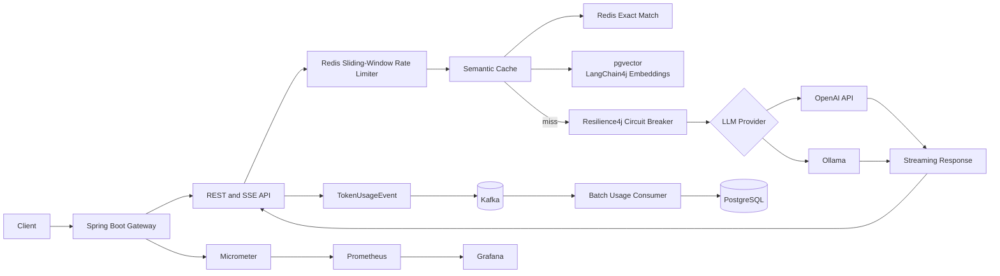

# Inference Token Gateway

Enterprise-oriented Spring Boot gateway for safely operating OpenAI-compatible
and local Ollama inference under token-based quotas, low-latency caching,
resilient provider access, asynchronous usage analytics, and production
observability.

## Capabilities

- **Real-time streaming**: Proxies OpenAI SSE and Ollama streaming responses
  through `POST /generate/stream`, with incremental token counting and
  mid-stream Redis quota enforcement.
- **Semantic caching**: Uses LangChain4j, local all-MiniLM-L6-v2 embeddings,
  and PostgreSQL pgvector. Prompts are served from the vector cache when cosine
  similarity meets the configurable `0.95` threshold.
- **Token rate limiting**: Atomic Redis sliding-window limits per user, with
  refunds for unused reservations.
- **Resilience4j circuit breakers**: Provider-specific failure-rate and
  slow-call protection with half-open recovery and standardized `502
  PROVIDER_UNAVAILABLE` responses.
- **Asynchronous analytics**: Publishes `TokenUsageEvent` records to Kafka;
  a batch consumer persists usage events and daily aggregates to PostgreSQL
  without adding database latency to inference requests.
- **Observability**: Spring Boot Actuator, Micrometer, Prometheus, and Grafana
  expose cache hit ratio, token consumption, rate-limit rejections, provider
  health, and JVM/application metrics.
- **Idempotency**: Persistent idempotency keys prevent duplicate request
  processing.

## Architecture



### Request lifecycle

1. Authenticate the request context and generate a correlation ID.
2. Reserve a conservative token budget in Redis.
3. Check Redis exact-match and pgvector semantic caches.
4. On a miss, call the selected provider through its circuit breaker.
5. Stream chunks to the client while counting response tokens and extending
   the reservation only when required.
6. Refund unused tokens and cache successful responses.
7. Publish usage asynchronously to Kafka after completion.
8. Batch-persist usage and daily aggregates in PostgreSQL.

## API

### Generate a response

```bash
curl -X POST http://localhost:8080/generate \
  -H 'Content-Type: application/json' \
  -d '{"userId":"user-alice","prompt":"Explain distributed rate limiting"}'
```

### Stream a response

```bash
curl -N -X POST http://localhost:8080/generate/stream \
  -H 'Content-Type: application/json' \
  -d '{"userId":"user-alice","prompt":"Explain distributed rate limiting"}'
```

The streaming endpoint returns `text/event-stream` events containing request
ID, response content, tokens consumed so far, completion state, and finish
reason.

Additional endpoints:

- `GET /api/status` — active provider and service status.
- `GET /usage/{userId}` — historical usage plus current Redis-window usage.
- `GET /actuator/health` — application and dependency health.
- `GET /actuator/prometheus` — Prometheus exposition format.

## Running the distributed system

### Prerequisites

- Docker and Docker Compose
- For local development without Docker: Java 21 and Maven

### Start the complete stack

```bash
docker compose up --build
```

Compose starts:

- Gateway privately on `127.0.0.1:8080`
- PostgreSQL with pgvector privately on `127.0.0.1:5433` (container port `5432`)
- Redis privately on `127.0.0.1:6380` (container port `6379`)
- Kafka in KRaft mode privately on `127.0.0.1:9092`
- Prometheus privately on `127.0.0.1:9090`
- Grafana privately on `127.0.0.1:3000`
- Caddy on ports `80` and `443` as the only public entrypoint

Grafana is provisioned automatically with a Prometheus datasource and an
Inference Gateway dashboard. The default credentials are `admin` / `admin`;
override them with `GRAFANA_ADMIN_USER` and `GRAFANA_ADMIN_PASSWORD`.

### Oracle Cloud Always Free rollout

The Compose file is intentionally configured for a hybrid deployment:

1. Infrastructure ports stay bound to loopback and are never exposed to the
   internet.
2. Caddy is the only internet-facing service and reverse-proxies the UI and
   API to the gateway over the private Compose network.
3. During private validation, use an SSH tunnel from your laptop:

   ```bash
   ssh -N -L 8080:127.0.0.1:8080 ubuntu@<ORACLE_VM_PUBLIC_IP>
   ```

   Then open `http://localhost:8080`. Prometheus and Grafana can be inspected
   with equivalent tunnels, for example
   `ssh -N -L 3000:127.0.0.1:3000 ubuntu@<ORACLE_VM_PUBLIC_IP>`.
4. For public access, point a DNS `A` record such as `gateway.example.com` at
   the VM public IP and start Compose with:

   ```bash
   DOMAIN=gateway.example.com docker compose up -d --build
   ```

   Open only TCP ports `80` and `443` in the Oracle security list and Ubuntu
   firewall. Caddy obtains and renews the HTTPS certificate automatically.

Do not open ports `5432`, `6379`, `9092`, `9090`, or `3000` in the Oracle
firewall. Keep `GRAFANA_ADMIN_PASSWORD` set to a strong secret even though
Grafana is loopback-only.

Stop the stack and remove persistent volumes with:

```bash
docker compose down -v
```

### Select an LLM provider

The simulated backend is the safe default and requires no external API key.

```bash
# OpenAI
LLM_PROVIDER=openai \
OPENAI_API_KEY="$OPENAI_API_KEY" \
docker compose up --build

# Local Ollama running on the host
LLM_PROVIDER=ollama \
OLLAMA_BASE_URL=http://host.docker.internal:11434 \
docker compose up --build
```

Useful configuration variables include:

| Variable | Default | Purpose |
|---|---:|---|
| `LLM_PROVIDER` | `simulated` | `simulated`, `openai`, or `ollama` |
| `OPENAI_DEFAULT_MODEL` | `gpt-4o-mini` | OpenAI model |
| `OLLAMA_DEFAULT_MODEL` | `llama3.2` | Ollama model |
| `RATE_LIMIT_TOKENS_PER_MINUTE` | `10000` | Per-user Redis quota |
| `SEMANTIC_CACHE_ENABLED` | `true` | Enable vector cache lookup |
| `SEMANTIC_SIMILARITY_THRESHOLD` | `0.95` | Semantic hit threshold |
| `KAFKA_USAGE_TOPIC` | `token-usage-events` | Usage event topic |
| `KAFKA_BATCH_SIZE` | `100` | Consumer batch size |

## Observability

The preconfigured Grafana dashboard visualizes:

- Cache hit percentage from `gateway.cache.requests`.
- Average tokens per completed request from
  `gateway.request.tokens`.
- Rate-limit rejection rate from `gateway.ratelimit.rejections`.

Prometheus configuration is in
[prometheus/prometheus.yml](/Users/meghna/Documents/Studio/github/inference-token-gateway/prometheus/prometheus.yml);
dashboard provisioning is under
[grafana/](/Users/meghna/Documents/Studio/github/inference-token-gateway/grafana/).

## Engineering tradeoffs

### Redis sliding window over a token bucket

The sliding window gives more precise per-minute accounting and makes refunds
straightforward, at the cost of storing more per-request entries in Redis.
The implementation favors accurate quota enforcement over the lower memory
footprint of a token bucket.

### Semantic cache over exact matching alone

Embeddings improve hit rate for equivalent prompts, but add embedding latency,
model memory, vector storage, and the risk of a false-positive response. The
`0.95` threshold is intentionally conservative, and Redis remains the fast
exact-match path.

### pgvector over a separate vector service

pgvector keeps cache metadata and operational data close to PostgreSQL and
reduces local deployment complexity. A dedicated vector database may provide
greater scale or specialized indexing, but introduces another service and
consistency boundary.

### Kafka over synchronous PostgreSQL writes

Kafka removes database write latency from the request path and enables replay,
batching, and independent consumer scaling. The cost is eventual consistency:
usage reports can lag briefly, and delivery requires durable producer,
consumer, and retry configuration.

### Circuit breakers and fallbacks

Circuit breakers protect the gateway and provider from retry storms and
resource exhaustion. They intentionally fail fast with a stable 502 response
once the provider is unhealthy; this prioritizes predictable latency over
best-effort completion.

### In-process embeddings

The all-MiniLM model avoids an external embedding API and its network cost,
but consumes application CPU and memory. This is a practical default for a
self-contained deployment; production teams can replace it with a managed
embedding service when scale or model governance requires it.

### Synchronous token accounting versus asynchronous persistence

Token counting remains on the streaming path because quota decisions must be
made before more content is emitted. Durable analytics are asynchronous because
they do not need to block the client response.

## Development and validation

Run the test suite with:

```bash
mvn clean test
```

Run the load-test helper after the stack is available:

```bash
python3 scripts/load_test.py
```

## Future directions

- Authentication and tenant-aware authorization.
- Kafka dead-letter handling and replay tooling.
- Multi-region Redis and PostgreSQL deployment.
- Provider-level cost accounting and model-specific tokenizers.
- Automated Grafana alerting for circuit-open, quota-rejection, and Kafka-lag
  conditions.

## Copyright

Copyright (c) 2026 Meghna Ravikumar. All rights reserved. No part of this
software may be reproduced or distributed without permission.
